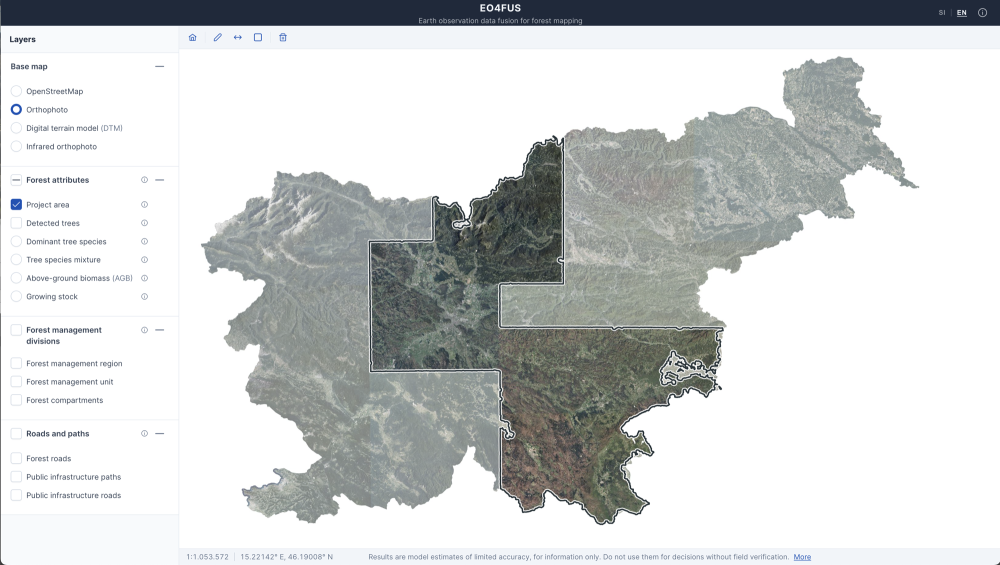
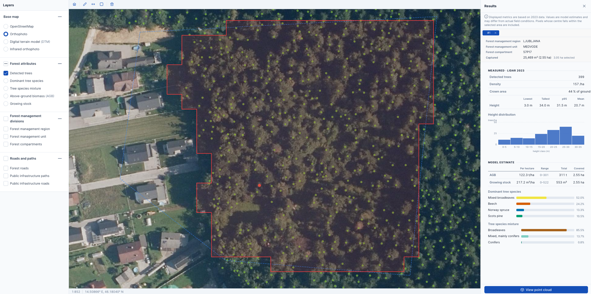

# eo4fus-webapp

Web map viewer for the EO4FUS project: a quick overview of forest conditions for a selected area in the part of Slovenia covered by the 2023 LiDAR survey.

It combines airborne laser scanning (LiDAR 2023), Sentinel-2 satellite imagery and field measurements to estimate metrics such as tree height, crown area, growing stock and above-ground biomass. Developed within a project fully funded by the European Space Agency (ESA), in collaboration between Flai, the Slovenian Forestry Institute (SFI) and the Research Centre of the Slovenian Academy of Sciences and Arts (ZRC SAZU).



*Main screen: the layer panel on the left and the map with the project area outlined.*

## How it works

- Pick layers in the layer panel: base maps, forest attributes (detected trees, dominant species, species mixture, biomass, growing stock), forest management divisions, roads and paths.
- Click the map, or draw an area, to get results for that spot: tree count and height distribution, crown area, and model estimates with their error.
- Open the LiDAR point cloud for a selected area, or measure distances and areas on the map.



*Exploring tree data: detected trees in a drawn area, with the results panel showing tree count, density, height distribution, biomass, growing stock and species shares.*

The interface is available in Slovenian and English. Displayed values are model estimates based on 2023 data and may differ from field conditions.

## Development

Built with Vue 3, Vite, OpenLayers and PrimeVue. Requires Node.js `^20.19.0` or `>=22.12.0`.

```sh
cp .env.example .env   # set the API and Flai app URLs
npm install
npm run dev            # dev server over HTTPS with a self-signed certificate
npm run build          # production build in dist/
npm run lint
```

## License

[MIT](LICENSE)
